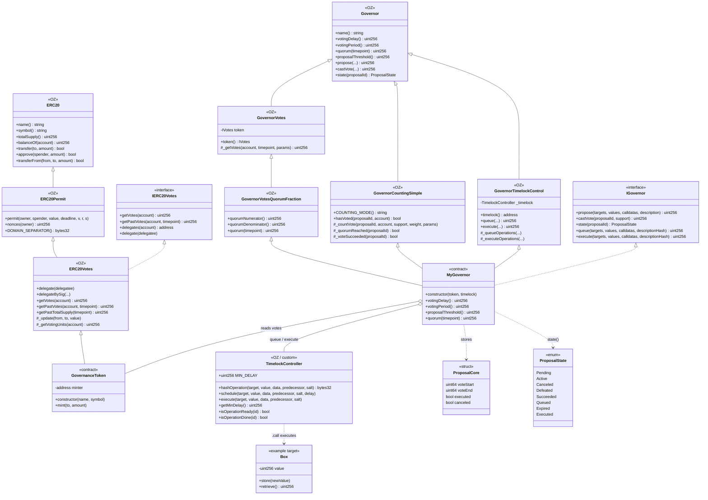

# Class diagram — DAO Governance & Timelock

> 🌐 **English** · [Español](./diagrama-de-clases-ES.md)

Structural view of the contracts, OpenZeppelin inheritance, and composition/usage relationships.

## Diagram (Mermaid)

## Key relationships

| From | To | Type | Reason |
|------|----|------|--------|
| `MyGovernor` | `GovernanceToken` | Association | `getPastVotes` at the proposal snapshot |
| `MyGovernor` | `TimelockController` | Association | Only successful proposals are queued/executed with a delay |
| `TimelockController` | Targets (`Box`, etc.) | Dependency | Safe arbitrary execution via low-level `.call` |
| `GovernanceToken` | Internal checkpoints | Composition (OZ) | Voting power history per block/timepoint |

## Design notes

1. **OZ v5 inheritance**: reuse audited modules; don't reinvent counting/quorum/timelock control.
2. **Timelock roles**: `PROPOSER_ROLE` → Governor; `EXECUTOR_ROLE` → `address(0)` or scoped roles; renounce `DEFAULT_ADMIN_ROLE` after setup.
3. **Separation of concerns**: the token knows nothing about proposals; the Governor runs no business logic; the Timelock is the only privileged caller towards targets.
