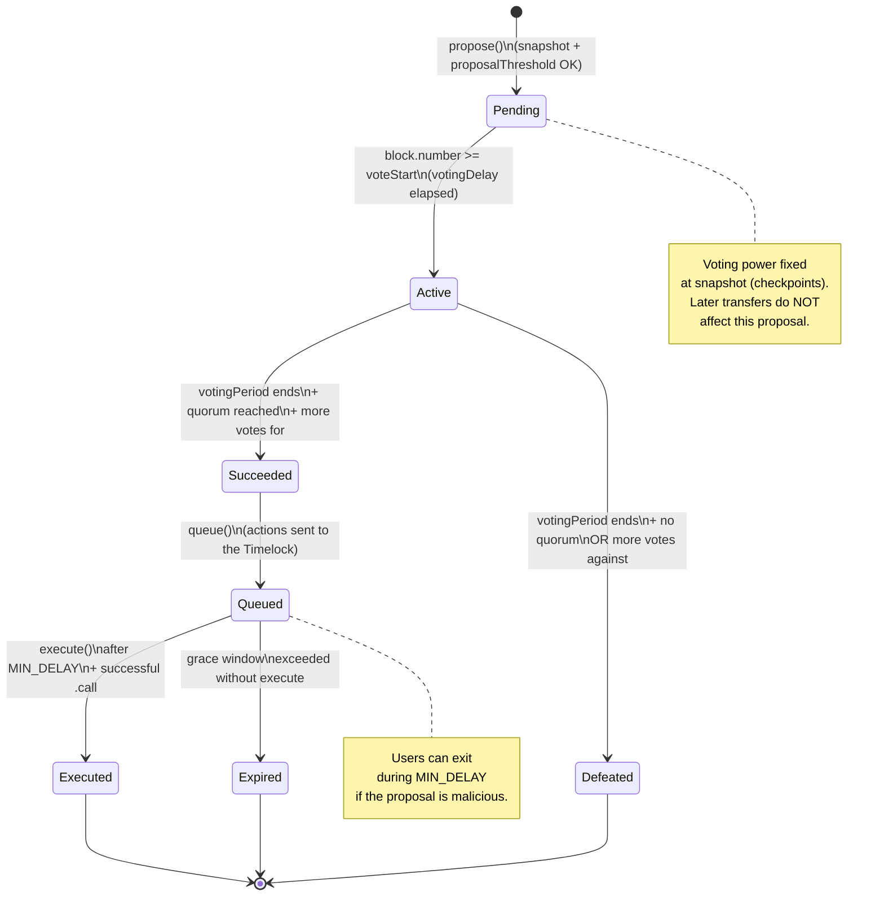
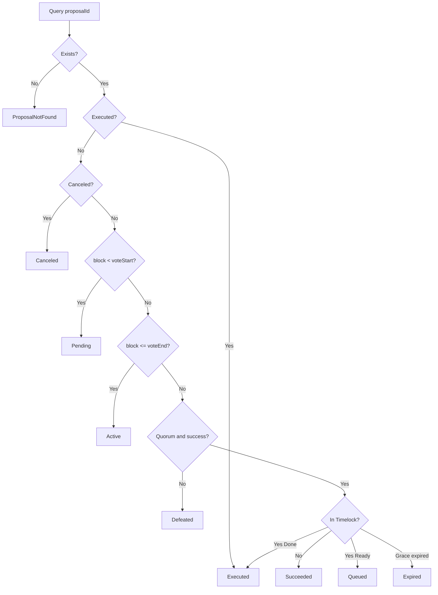

# Flow diagram — Proposal state machine

> 🌐 **English** · [Español](./diagrama-de-flujo-ES.md)

Official transitions in the lifecycle of a DAO proposal (module 10).

## Diagram (Mermaid)

## Transition table

| Current state | Condition | Next state | Error if violated |
|---------------|-----------|------------|-------------------|
| — | `getVotes(proposer) >= proposalThreshold` | `Pending` | (custom: threshold / unauthorized) |
| `Pending` | `block >= voteStart` | `Active` | — (read-only `state`) |
| `Active` | Period open | stays `Active` | `VotingClosed` if attempted outside |
| `Active` | End + quorum + for > against | `Succeeded` | — |
| `Active` | End + quorum/vote failure | `Defeated` | — |
| `Succeeded` | `queue(...)` | `Queued` | `ProposalNotSucceeded` |
| `Queued` | `now < eta` (delay) | stays `Queued` | `MinDelayNotMet` on execute |
| `Queued` | delay OK + `.call` OK | `Executed` | `ExecutionFailed` |
| `Queued` | grace period expired | `Expired` | — |
| any | invalid `proposalId` | — | `ProposalNotFound` |

## `state(proposalId)` decision flow

## Invariants

1. A proposal **never** jumps from `Active` to `Executed` without going through `Succeeded` → `Queued`.
2. Voting weight is read with `getPastVotes(account, snapshot)` — not the current balance.
3. Every on-chain execution of proposal actions goes through the Timelock + `MIN_DELAY`.
