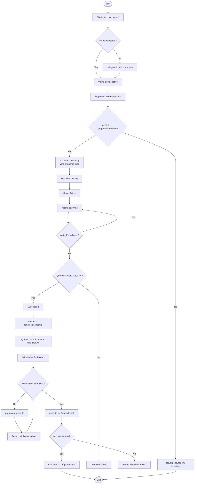
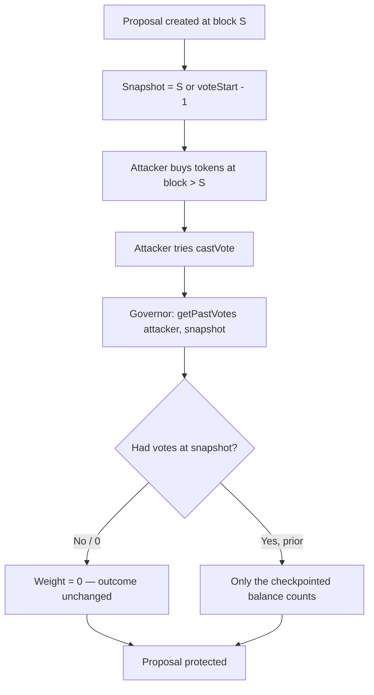
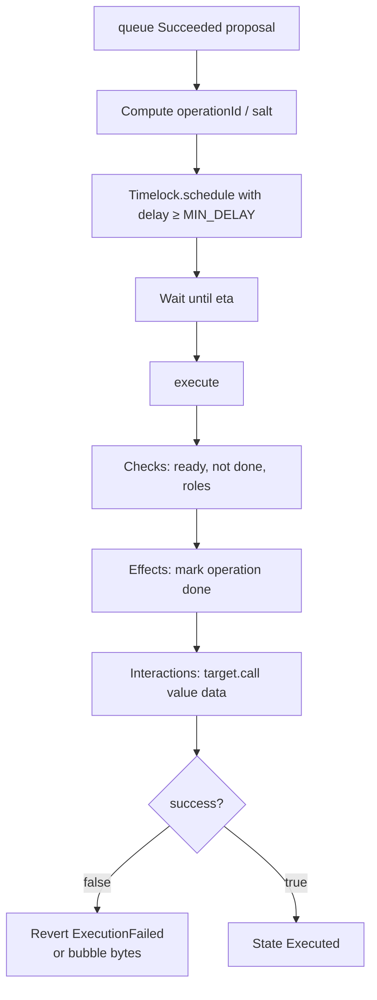
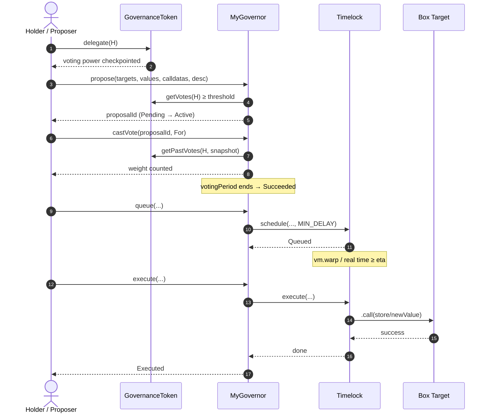

# Flowchart — Full DAO governance cycle

> 🌐 **English** · [Español](./flujograma-ES.md)

End-to-end flow between actors and contracts: from delegation to execution on the target.

## Actors

| Actor | Role |
|-------|------|
| Token Holder | Holds `GovernanceToken`; must delegate to vote |
| Proposer | Holder with votes ≥ `proposalThreshold` |
| Voter | Holder (or delegate) voting For / Against / Abstain |
| Anyone / Executor | Whoever calls `queue` / `execute` once conditions are met |
| Timelock | Contract enforcing `MIN_DELAY` and executing `.call` |
| Target | Governed contract (e.g. `Box`) |

---

## Main flowchart (Mermaid)

---

## Anti flash-loan / double-voting flowchart

---

## Timelock execution flowchart (detail)

---

## Simplified sequence (Delegate → Execute)

---

## Operational summary

1. **No `delegate`, no vote** — the ERC-20 balance alone is not enough.
2. **Snapshot at creation / vote start** — later transfers don't count for that proposal.
3. **Winning the vote ≠ immediate execution** — always Timelock + `MIN_DELAY`.
4. **Checked `.call`** — target failure ⇒ `ExecutionFailed`.
5. **Foundry tests** must walk this whole flowchart plus the error paths (`MinDelayNotMet`, `VotingClosed`, `ProposalNotFound`, `ProposalNotSucceeded`).
